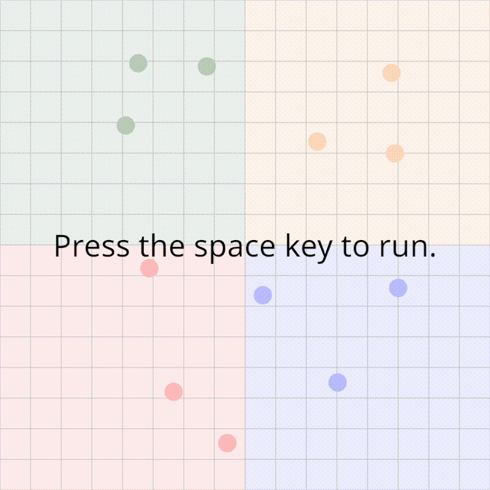

# Pong Wars

跳ね回るボールによる陣取り合戦をシミュレーションします。



## 実行方法

プロジェクトのルートディレクトリで以下のコマンドを実行します。
Rustのインストールが必要です。

```
cargo run --release
```

## 操作方法

スペースキーで再生/停止を切り替えることができます。

## 技術スタック

- **プログラミング言語**: [Rust](https://rust-lang.org/)
- **フレームワーク**: [nannou](https://github.com/nannou-org/nannou)
